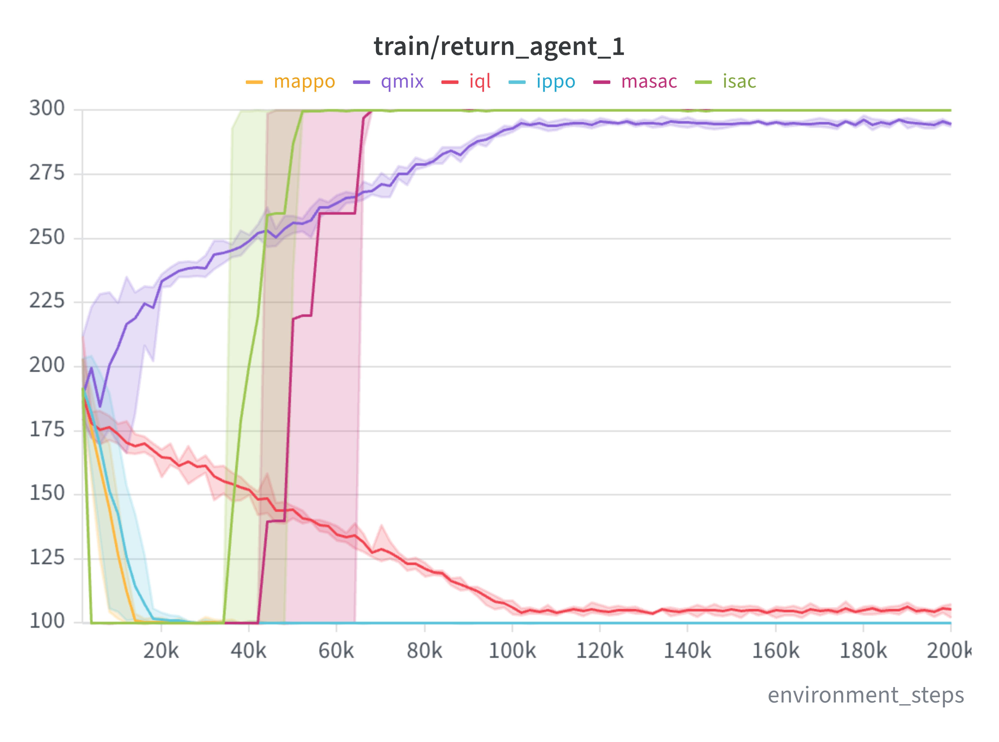
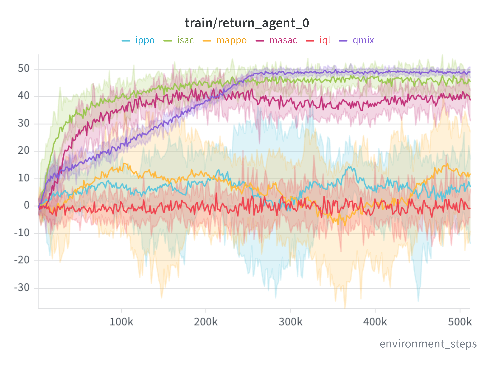
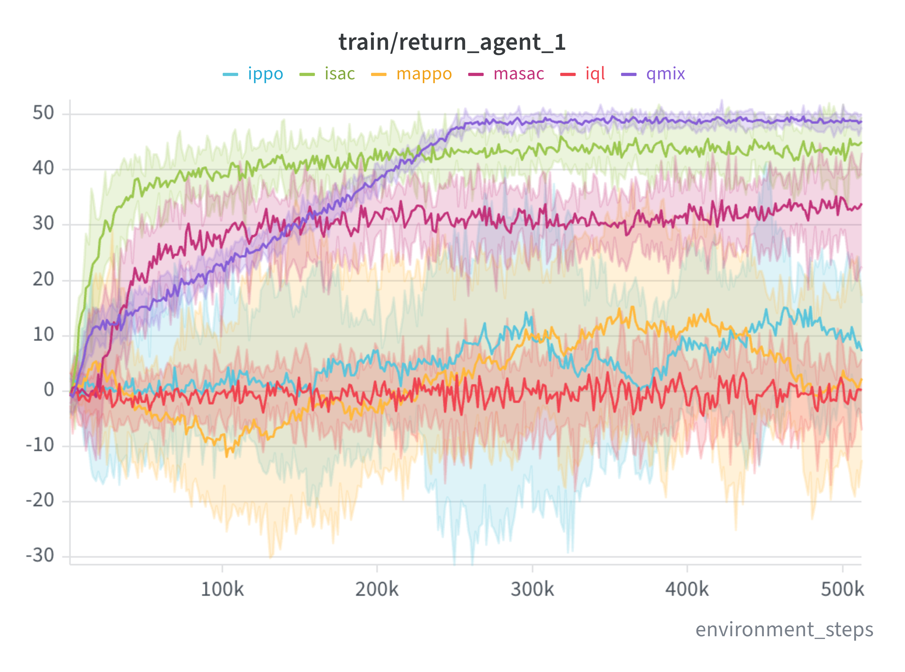
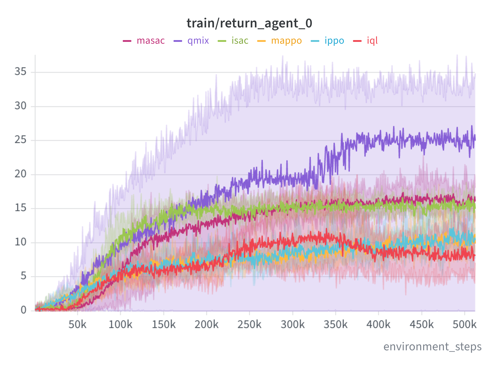
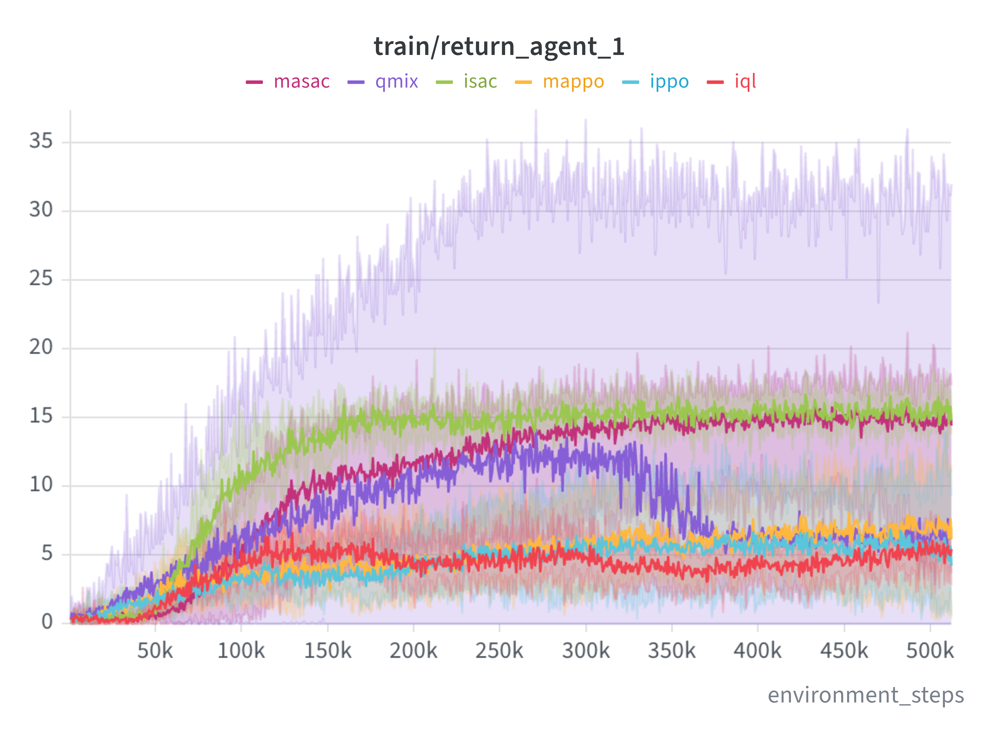

ISAC ([Independent Soft Actor Critic](https://proceedings.mlr.press/v80/haarnoja18b)) is incredibily effective in social dilemmas.
For a recent work, I have been testing classic MARL algorithms on classic social dilemmas, and I noticed that in most of the literature, [PPO](https://arxiv.org/abs/1707.06347) and its variants are usually the only algorithms tested and used for baselines. Clearly the PPO family has its merits, especially in complex environments, and, recently, for LLM tuning, but it seems that when considering social dilemmas, the SAC family should be the standard baseline.

I have compared these algorithms: MAPPO, IPPO, QMIX, IQL, ISAC and MASAC. [QMIX](https://proceedings.mlr.press/v80/rashid18a.html) is there as a shared reward baseline. I fine-tuned all algorithms using the sum of the rewards as score, the architecture for the Prisoner's Dilemma is an MLP, for the Coin Game and Clenaup-Lite is a Hawk network.

## Prisoner's Dilemma
The first interesting results is already clear from the Prisoner's Dilemma. MAPPO and IPPO immediately fall into the Nash equilibrium of mutual defection, obtaining a score of 1 (which in the graph is 100 as it is the cumulative episodic reward). IQL takes a bit longer, but eventually also ends up close to the Nash. QMIX on the ohter hand goes in the right direction and gets pretty close to the mutual cooperation solution, which is _not stable_, but it is the optimal social welafre for the agents. ISAC and MASAC are the only two algorithms that actually converge to the optimum, reaching across all seeds. It is even more interesting the fact that both algorithms initially fall into the Nash equilibrium, but manage to escape it.

<figure>

  
  

  <figcaption>Training runs for the iterated prisoner’s dilemma.</figcaption>
</figure>

Obviously a single test on the Prisoner's Dilemma means nothing, since it is a simple matrix game. To check whether the SAC algorithms are actually better at social dilemmas, I also tested on the [Coin Game](https://arxiv.org/abs/1707.01068) and [Cleanup-Lite](https://proceedings.iclr.cc/paper_files/paper/2025/hash/718a3e764e63a130323c5b5abf4ac332-Abstract-Conference.html).

## Coin Game
The Coin Game is basically a generalization of the Prisoner's Dilemma extended to a grid world. Each agent can pick up coins, picking up the one of its color gives a positive reward, picking up the ones of the other color gives a smaller positive reward plus a penalty to the other agent. The optimal solution is for both agents to pick up only their own coins. We can immediately see that in this case, having access to the full reward is very advantageous, and QMIX reaches the highest reward for the two agents. IQL, MAPPO and IPPO all fail to learn a good policy, being very noisy across seeds. Both MASAC and ISAC are actually faster than QMIX at reaching high rewards, but they can't quite obtain the same level of performance (which is expected). Interestingly enough, ISAC performs better than MASAC and gets very close to QMIX, while having no information about the other agent's reward.

<figure>

  
  

  <figcaption>Training runs for the coin game.</figcaption>
</figure>

## Cleanup-Lite
Finally, Cleanup-Lite is a more complex environment, where agents have to clean a river of waste and collect apples. Cleaning gives no reward, but if the river gets too dirty, the apples stop spawning. With access to the total reward, QMIX finds a solution where one agent mostly cleans and the other collects apples. Once again, IQL, MAPPO and IPPO fail to learn a good policy, increasing the reward a bit at the beginning, but stabilizng at a low level. MASAC and ISAC instead perform really good, and, in particular, they find a much more fair solution than QMIX, where both agents clean and collect apples. Considering the sum of the rewards, we can see that qualitatevely QMIX and ISAC reach basically the same value around $30$, but ISAC is much more fair, with both agents reaching around $15$ each, while QMIX has one agent reaching $25$ and the other $5$. 

<figure>

  
  

  <figcaption>Training runs for the cleanup game.</figcaption>
</figure>

## Conclusion
I know that these tests are far from exhaustive, but I believe that there are enough signs that the SAC family of algorithms should be included more often in baselines for social dilemmas, since just comparing with MAPPO and IPPO in these settigns may not be enough.
